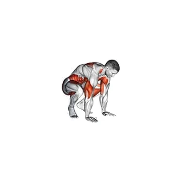

# Burpee

## Description

Le burripee est un exercice de conditionnement complet du corps qui combine un squat, la planche, pompe et vertical saut dans un mouvement continu. Il élève rapidement la fréquence cardiaque, développe l'endurance musculaire dans tout le corps, et ne nécessite aucun équipement, en faisant un incontournable de l'entraînement à haute intensité d'intervalle et des séances de conditionnement métabolique.

## Groupes musculaires

Bras, Épaules, Jambes, Fessiers, Abdominaux, Pecs

## Matériel requis

Aucun matériel

## Instructions

- Commencez par vous tenir debout avec les pieds à la largeur de l'épaule et les bras sur vos côtés.
- Accrochez-vous et placez vos mains sur le sol devant vos pieds, à peu près la largeur des épaules.
- Sautez ou marchez les deux pieds en position de planche haute avec votre corps formant une ligne droite de la tête aux talons.
- Faites une pompe complète en abaissant votre poitrine au sol, puis appuyez sur la position de la planche. Gardez votre sangle abdominale brassé et vos hanches à niveau.
- Sautez ou marchez les pieds en avant pour atterrir juste en dehors de vos mains, en revenant à une position de squat bas.
- Poussez sur les talons et propulsez-vous vers le haut dans un saut vertical, en tendant les bras au-dessus de la tête.
- Atterrissez doucement avec vos genoux légèrement pliés, puis tomber immédiatement dans la prochaine répétition. Continuer à bouger pour le temps prescrit ou le nombre de répétition.

## Bénéfices

- Incarne l'endurance cardiovasculaire et l'endurance musculaire simultanément
- Fonctionne tout le corps : jambes, poitrine, épaules, triceps et sangle abdominale dans chaque répétition
- Brûle un grand nombre de calories par minute
- Nécessite aucun équipement et un espace minimal
- Facilement gradué en haut ou en bas en ajustant la vitesse, la profondeur de pompe ou la hauteur de saut
- Développe la ténacité mentale grâce à un effort soutenu de haute intensité

## Muscles sollicités

- Bras, Épaules, Jambes, Fessiers, Abdominaux, Pecs

## Variantes et alternatives

- La moitié du Burpee (pas de pompe, pas de saut)
- Pas de Burpee-Up-pompe
- Burpee marche arrière (impact inférieur)
- Saut de caisson Burpee
- Tirage de la Burpee
- Burpee Saut à large portée
- Saut à la tire Burpee
- jambe Burpee à une seule personne
- Burpee avec montagnard
- Burpee (avec tirages d'haltères ou presses)

## Points de vigilance

- Ne sacrifiez pas la qualité des appuis à la vitesse.
- Arrêtez l’exercice en cas de douleur ou de perte de contrôle.

## Codes

- Slug d’exercice : `burpee`
- Slug de pilier : `cardio`
- Slug d’équipement : `no-equipment`
