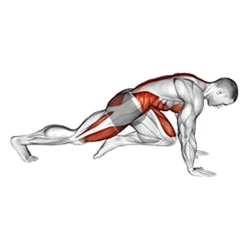

# Montées de genoux en gainage

## Description

Le grimpeur est un exercice dynamique en position de planche dans lequel vous ramenez rapidement les genoux vers la poitrine en alternance. Il élève vite la fréquence cardiaque et sollicite fortement la sangle abdominale, les fléchisseurs de hanche et les stabilisateurs des épaules. Utilisé en HIIT, à l’échauffement ou dans des circuits métaboliques, il fournit un travail intense en peu de temps.

## Groupes musculaires

Épaules, Jambes, Fessiers, Abdominaux

## Matériel requis

Aucun matériel

## Instructions

- Commencez par une position de planche haute avec vos mains directement sous vos épaules et votre corps formant une ligne droite de la tête aux talons.
- Faites pression sur votre sangle abdominale et pressez vos fessiers. Vos hanches doivent rester à niveau tout au long du mouvement, et non rebondir de haut en bas.
- Ramenez le genou droit vers la poitrine en gardant le pied décollé du sol.
- Commuter rapidement les jambes : prolonger la jambe droite jusqu'à la position de la planche tout en tirant votre genou gauche vers votre poitrine.
- Continuez à alterner les jambes aussi rapidement que possible tout en maintenant un dos plat et des épaules stables.
- Respirez rythmiquement, expirez sur chaque entraînement du genou. Évitez de laisser vos hanches piquer ou saper.
- Travaillez à intervalles : 20 à 40 secondes de grimpeurs rapides suivis de 10 à 30 secondes de repos, pour plusieurs tours.

## Bénéfices

- Élevez rapidement la fréquence cardiaque pour le conditionnement cardiovasculaire
- Incline la sangle abdominale (en particulier l'anti-rotation et l'anti-extension) sous fatigue
- Développe l'endurance dans les flexeurs de la hanche et les stabilisateurs d'épaule
- Nécessite aucun équipement et un espace minimal
- Doubles comme un échauffement dynamique avant le levage ou le sport
- Facilement graduée en changeant de vitesse ou en ajoutant des variations

## Muscles sollicités

- Épaules, Jambes, Fessiers, Abdominaux

## Variantes et alternatives

- Grimpeur lent (tempo contrôlé)
- Grimpeur croisé (genou vers le coude opposé)
- Grimpeur Spiderman (genou vers l’extérieur de la main du même côté)
- Grimpeur avec déplacement latéral
- Déclin de la montagne Grimpeur (pieds surélevés)
- Escalade coulissante de montagne (avec sliders ou serviettes)
- Burpee avec montagnard
- Escalade verticale de montagne
- Grimpeur avec sangles de suspension

## Points de vigilance

- Ne sacrifiez pas la qualité des appuis à la vitesse.
- Arrêtez l’exercice en cas de douleur ou de perte de contrôle.

## Codes

- Slug d’exercice : `mountain-climber`
- Slug de pilier : `cardio`
- Slug d’équipement : `no-equipment`
