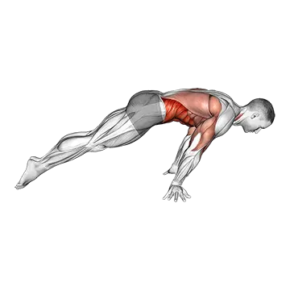

# Planche lean

## Description

La planche maigre est une progression calisthnique vers la planche complète. De la position pompe, vous penchez votre corps vers l'avant afin que vos épaules passent au-delà de vos mains, en déplaçant votre centre de gravité sur vos paumes. Plus vous penchez, plus la position approche une planche.

## Groupes musculaires

Bras, Épaules, Abdominaux, Pecs

## Matériel requis

Aucun matériel

## Instructions

- Commencez par une position de planche haute avec les mains à la largeur des épaules à l'écart sur le sol.
- Tournez légèrement les mains vers l'extérieur (des doigts pointant vers les côtés) pour protéger vos poignets.
- Contractez la sangle abdominale. Pressez vos fessiers. Protâchez vos épaules (poussez le sol loin).
- Penchez votre corps en avant en déplaçant le poids sur vos mains — vos épaules devraient passer au-delà de vos poignets.
- Maintenez les bras droits et une ligne droite du corps.
- Maintenez la position de 10 à 30 secondes.
- Augmentez progressivement le poids avant en quelques semaines.
- Vos pieds deviendront plus légers. Finalement, ils commencent à soulever lorsque vous approchez de l'équilibre de la planche.

## Bénéfices

- Progression de la planification fondamentale
- Développe une force deltoïde antérieure extrême
- Développe le conditionnement du poignet et de l'avant-bras
- Développe la sangle abdominale de soutien sous le maigre avant
- Aucun équipement nécessaire
- Tremplin essentiel à la planche complète

## Muscles sollicités

- Bras, Épaules, Abdominaux, Pecs

## Variantes et alternatives

- Planche complète
- Planche à étrier
- Planche à grenouilles (planche à écailles)
- Planche Lean sur Parallettes
- Pseudo Planche Pompe

## Points de vigilance

- Évitez l’élan et conservez une amplitude contrôlée.
- Arrêtez l’exercice en cas de douleur articulaire.

## Codes

- Slug d’exercice : `lean-planche`
- Slug de pilier : `proprioception`
- Slug d’équipement : `no-equipment`
