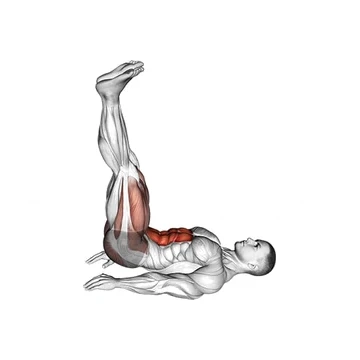

# Relevé de jambes allongé

## Description

Le relèvement de la jambe allongée est un exercice de base où vous vous couchez sur le dos et soulevez les deux jambes droites du sol jusqu'à la verticale (ou aussi près que votre force le permet), puis les baissent sous contrôle. Il développe les abdominaux inférieurs et les flexeurs de hanche, et entraîne la sangle abdominale pour résister à l'arêtement du bas du dos lorsque les jambes descendent.

## Groupes musculaires

Jambes, Abdominaux

## Matériel requis

Aucun matériel

## Instructions

- Allongez-vous à plat sur le dos sur le sol avec vos jambes droites et les bras étendus sur vos côtés, paumes vers le bas.
- Placez vos mains à plat sous vos fessiers pour un soutien plus bas-dos si nécessaire.
- Contractez votre sangle abdominale dur. Appuyez fermement sur votre dos inférieur dans le sol et gardez-le là tout au long de l'série.
- Relever les deux jambes droites du sol en contractant vos abdos et vos flexeurs de hanche. Gardez vos jambes droites ou avec un léger virage dans les genoux.
- Continuez à soulever jusqu'à ce que vos jambes atteignent la verticale (90 degrés) ou la hauteur que votre portée permet tout en gardant votre dos inférieur enfoncé dans le sol.
- Pause brièvement en haut, puis baissez lentement les jambes en bas sous contrôle sur un nombre de deux à trois secondes.
- Arrêtez juste avant que vos talons touchent le sol — gardez la tension sur les abdominaux tout au long de l'série.
- Si votre dos inférieur se lève du sol, vous avez baissé trop loin. Réduire la portée jusqu'à ce que vous puissiez maintenir le contact arrière.

## Bénéfices

- Développe les abdos inférieurs et les flexeurs de la hanche
- Entraîne la sangle abdominale pour résister à l'arche bas-arrière
- Aucun équipement nécessaire — fonctionne n'importe où
- Plus facile à évaluer que les variations de suspensions
- Excellent accessoire pour ascenseurs composés
- Améliore la flexibilité de la hanche et l'endurance de la sangle abdominale

## Muscles sollicités

- Jambes, Abdominaux

## Variantes et alternatives

- Élevée à simple lévrier
- Alternativement jambe jambe
- Levez la hanche du pied
- Levez la jambe torsadée
- Levage de la hanche du pied suspendu (avance)
- Levage de la jambe couchée (régression)
- Levage des jambes pondérales (poids des chevilles)
- Relevé de jambes allongé tempo (4 s de descente)
- Levez la jambe de menthe latérale
- Allonger le haut de la jambe

## Points de vigilance

- Évitez l’élan et conservez une amplitude contrôlée.
- Arrêtez l’exercice en cas de douleur articulaire.

## Codes

- Slug d’exercice : `lying-leg-raise`
- Slug de pilier : `proprioception`
- Slug d’équipement : `no-equipment`
