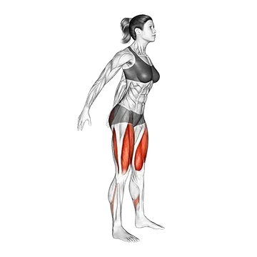

# Squat au poids du corps

## Description

Le squat au poids du corps est le squat de poids du corps fondamental – exécuté sans poids comme un échauffement, un exercice de conditionnement, ou un outil d'enseignement de motif de mouvement. C'est l'exercice de passerelle à toutes les variations de squat chargé. CrossFit popularisé le terme « squat au poids du corps » pour le distinguer des squats pondérés.

## Groupes musculaires

Jambes, Fessiers, Abdominaux

## Matériel requis

Aucun matériel

## Instructions

- Tenez-vous droit avec les pieds à la largeur des épaules, les orteils légèrement tournés.
- - Lève la poitrine, regarde droit devant.
- Asseyez-vous les hanches derrière vous comme si vous allais chercher une chaise derrière vous.
- Pliez les genoux et baissez les hanches.
- Descendez jusqu'à ce que votre pli de hanche tombe sous le haut de vos genoux (au moins parallèle).
- Traversez votre pied entier – en particulier les talons – pour vous relever.
- Serrez vos fessiers en haut.
- Répétez le nombre de répétitions souhaités. Visez 15 à 50 répétitions comme un exercice de conditionnement ou de échauffement.

## Bénéfices

- Squat de poids du corps fondamental pour tous les niveaux de fitness
- Excellent échauffement avant les squats chargés
- Développe une endurance quadriceps et fessier
- Enseigne le motif de mouvement squat
- Aucun équipement nécessaire — fonctionne n'importe où
- Utilisé en CrossFit, formation militaire et réhabilitation

## Muscles sollicités

- Jambes, Fessiers, Abdominaux

## Variantes et alternatives

- Poids du corps
- Squat de la berce
- Squat de gobelet
- Squat sauté
- Squat Sumo
- Fente de marche
- Marche de canard
- Squat à large air
- Squat d'air Sumo

## Points de vigilance

- Évitez l’élan et conservez une amplitude contrôlée.
- Arrêtez l’exercice en cas de douleur articulaire.

## Codes

- Slug d’exercice : `air-squat`
- Slug de pilier : `strength`
- Slug d’équipement : `no-equipment`
