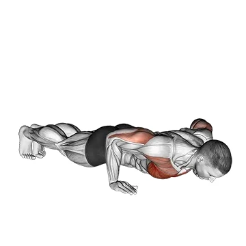

# Push-up

## Description

The push-up is a fundamental bodyweight strength exercise. From a high plank, lower the chest toward the floor while keeping the body aligned, then press back to the starting position.

## Muscle Groups

Chest, shoulders, triceps and core.

## Équipement requis vérifié

- Aucun matériel requis.

## Equipment Required

No equipment.

## Instructions

1. Place the hands slightly wider than shoulder-width and extend the legs behind you.
2. Brace the core and keep a straight line from head to heels.
3. Bend the elbows and lower the chest under control.
4. Stop before losing body alignment.
5. Press through the palms to return to the high plank.

## Benefits

- Strengthens the chest, shoulders and triceps.
- Develops whole-body bracing and shoulder stability.
- Requires no equipment.

## Muscles Worked

- Pectorals
- Triceps
- Anterior deltoids
- Core

## Variations and Alternatives

- Knee push-up
- Incline push-up
- Diamond push-up
- Decline push-up

## Points de vigilance

- Keep the neck neutral and the trunk braced throughout the movement.
- Reduce the range or use an incline variation if the lower back or shoulders compensate.
- Stop for sharp wrist, elbow, or shoulder pain.

## Codes

- Exercise slug: `push-up`
- Pillar slug: `strength`
- Equipment slug: `no-equipment`
