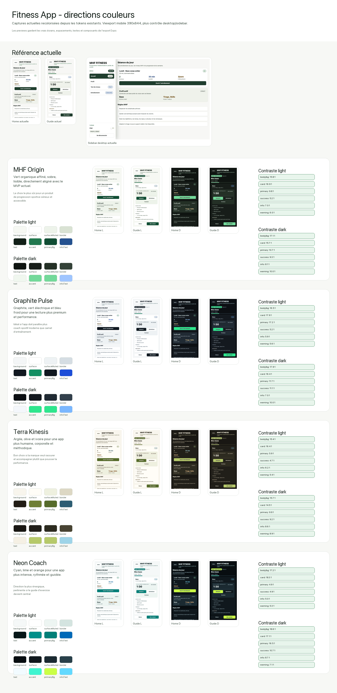
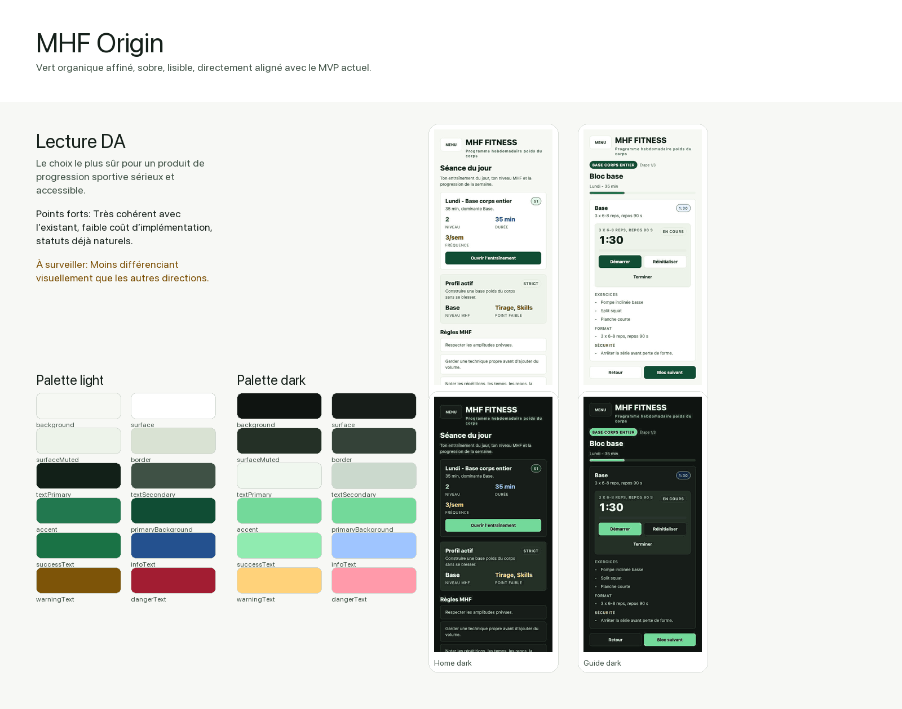
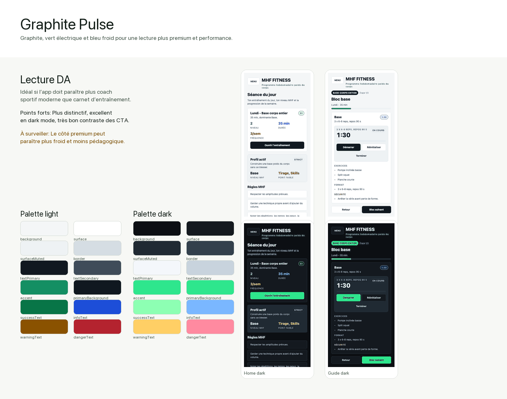
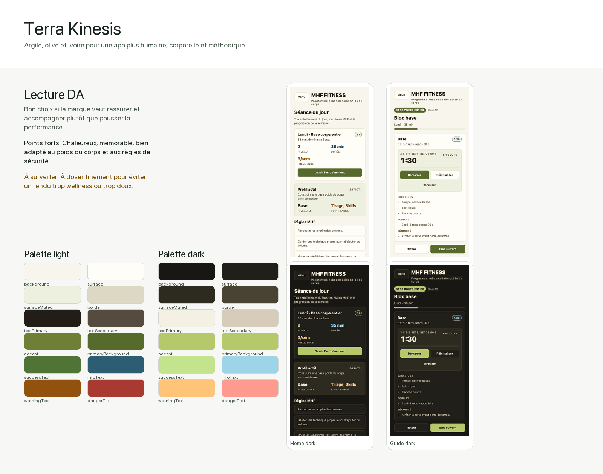
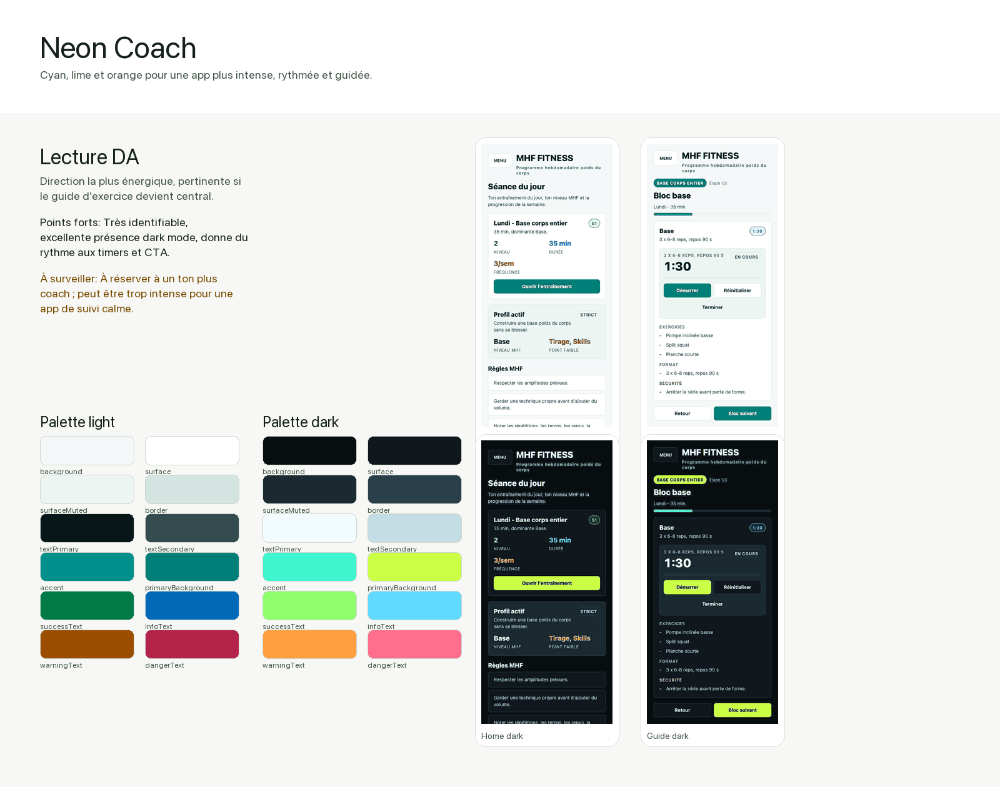

# Directions couleurs - Fitness App

Source: captures réelles de l’export web Expo, générées le 26 juin 2026 depuis les écrans Login, Accueil, Test niveau, Entraînement, Guide d’exercice, Profil et Desktop/sidebar.

## Captures actuelles utilisées

- `screenshots/current-login-mobile.png`
- `screenshots/current-home-mobile.png`
- `screenshots/current-level-test-mobile.png`
- `screenshots/current-training-mobile.png`
- `screenshots/current-training-guide-mobile.png`
- `screenshots/current-profile-mobile.png`
- `screenshots/current-home-desktop.png`

## ACREA Origin

- Positionnement: Le choix le plus sûr pour un produit de progression sportive sérieux et accessible.
- Points forts: Très cohérent avec l’existant, faible coût d’implémentation, statuts déjà naturels.
- À surveiller: Moins différenciant visuellement que les autres directions.

### Tokens light

| Token | Valeur |
| --- | --- |
| `background` | `#f6f8f3` |
| `surface` | `#ffffff` |
| `surfaceElevated` | `#ffffff` |
| `surfaceMuted` | `#edf3ea` |
| `border` | `#d9e2d3` |
| `borderSoft` | `#e8eee4` |
| `textPrimary` | `#122018` |
| `textSecondary` | `#3f5145` |
| `textMuted` | `#68766d` |
| `accent` | `#22784f` |
| `accentSoft` | `#ddf2e6` |
| `primaryBackground` | `#104d34` |
| `primaryText` | `#ffffff` |
| `inputBackground` | `#ffffff` |
| `dangerText` | `#a21d32` |
| `dangerSurface` | `#ffe8ec` |
| `successText` | `#1a7245` |
| `successSurface` | `#e1f5e9` |
| `infoText` | `#24518f` |
| `infoSurface` | `#e8f1ff` |
| `warningText` | `#7d5408` |
| `warningSurface` | `#fff3cf` |

### Tokens dark

| Token | Valeur |
| --- | --- |
| `background` | `#0f1411` |
| `surface` | `#171d19` |
| `surfaceElevated` | `#202720` |
| `surfaceMuted` | `#243026` |
| `border` | `#344238` |
| `borderSoft` | `#29342d` |
| `textPrimary` | `#f0f7ef` |
| `textSecondary` | `#cbd9cd` |
| `textMuted` | `#9aac9f` |
| `accent` | `#73d99a` |
| `accentSoft` | `#1e3d2b` |
| `primaryBackground` | `#73d99a` |
| `primaryText` | `#08160f` |
| `inputBackground` | `#121713` |
| `dangerText` | `#ff9aaa` |
| `dangerSurface` | `#3a1820` |
| `successText` | `#90ebb0` |
| `successSurface` | `#163622` |
| `infoText` | `#9fc5ff` |
| `infoSurface` | `#172b46` |
| `warningText` | `#ffd27a` |
| `warningSurface` | `#352915` |

### Contrastes clés

| Pair | Light | Dark |
| --- | ---: | ---: |
| Body/background | 15.8:1 | 17.1:1 |
| Body/card | 16.9:1 | 15.7:1 |
| Primary button | 9.8:1 | 10.7:1 |
| Success badge | 5.2:1 | 9.3:1 |
| Info badge | 7.0:1 | 8.1:1 |
| Warning badge | 6.0:1 | 10.0:1 |
| Danger badge | 6.5:1 | 7.9:1 |

## Graphite Pulse

- Positionnement: Idéal si l’app doit paraître plus coach sportif moderne que carnet d’entraînement.
- Points forts: Plus distinctif, excellent en dark mode, très bon contraste des CTA.
- À surveiller: Le côté premium peut paraître plus froid et moins pédagogique.

### Tokens light

| Token | Valeur |
| --- | --- |
| `background` | `#f4f6f7` |
| `surface` | `#ffffff` |
| `surfaceElevated` | `#ffffff` |
| `surfaceMuted` | `#eef2f4` |
| `border` | `#d5dde3` |
| `borderSoft` | `#e6edf1` |
| `textPrimary` | `#111820` |
| `textSecondary` | `#3f4c59` |
| `textMuted` | `#64717d` |
| `accent` | `#148f63` |
| `accentSoft` | `#dff8ec` |
| `primaryBackground` | `#101820` |
| `primaryText` | `#f7fbff` |
| `inputBackground` | `#ffffff` |
| `dangerText` | `#b4232f` |
| `dangerSurface` | `#ffe3e8` |
| `successText` | `#087547` |
| `successSurface` | `#dcfce7` |
| `infoText` | `#1d4ed8` |
| `infoSurface` | `#eaf2ff` |
| `warningText` | `#8a5200` |
| `warningSurface` | `#fff0c2` |

### Tokens dark

| Token | Valeur |
| --- | --- |
| `background` | `#0c0f13` |
| `surface` | `#14191f` |
| `surfaceElevated` | `#1b222a` |
| `surfaceMuted` | `#202a33` |
| `border` | `#33404c` |
| `borderSoft` | `#26313b` |
| `textPrimary` | `#f4f7fb` |
| `textSecondary` | `#c8d3dd` |
| `textMuted` | `#93a2b0` |
| `accent` | `#2ee68d` |
| `accentSoft` | `#12382a` |
| `primaryBackground` | `#2ee68d` |
| `primaryText` | `#06110b` |
| `inputBackground` | `#10151a` |
| `dangerText` | `#ff8aa0` |
| `dangerSurface` | `#3b1821` |
| `successText` | `#8dffb3` |
| `successSurface` | `#123423` |
| `infoText` | `#7ab7ff` |
| `infoSurface` | `#132a45` |
| `warningText` | `#ffcf65` |
| `warningSurface` | `#332713` |

### Contrastes clés

| Pair | Light | Dark |
| --- | ---: | ---: |
| Body/background | 16.5:1 | 17.9:1 |
| Body/card | 17.9:1 | 16.4:1 |
| Primary button | 17.2:1 | 11.7:1 |
| Success badge | 5.2:1 | 11.1:1 |
| Info badge | 5.9:1 | 7.0:1 |
| Warning badge | 5.6:1 | 10.0:1 |
| Danger badge | 5.4:1 | 7.0:1 |

## Terra Kinesis

- Positionnement: Bon choix si la marque veut rassurer et accompagner plutôt que pousser la performance.
- Points forts: Chaleureux, mémorable, bien adapté au poids du corps et aux règles de sécurité.
- À surveiller: À doser finement pour éviter un rendu trop wellness ou trop doux.

### Tokens light

| Token | Valeur |
| --- | --- |
| `background` | `#f8f5ed` |
| `surface` | `#fffdf7` |
| `surfaceElevated` | `#ffffff` |
| `surfaceMuted` | `#eef0df` |
| `border` | `#ddd8c4` |
| `borderSoft` | `#ebe6d6` |
| `textPrimary` | `#221d16` |
| `textSecondary` | `#554b3e` |
| `textMuted` | `#736957` |
| `accent` | `#6f7f35` |
| `accentSoft` | `#ebf2cf` |
| `primaryBackground` | `#566b2b` |
| `primaryText` | `#ffffff` |
| `inputBackground` | `#fffdf7` |
| `dangerText` | `#a93a32` |
| `dangerSurface` | `#ffe5df` |
| `successText` | `#4f7436` |
| `successSurface` | `#e8f2d8` |
| `infoText` | `#2d5d73` |
| `infoSurface` | `#e2f1f5` |
| `warningText` | `#92520e` |
| `warningSurface` | `#fff0ce` |

### Tokens dark

| Token | Valeur |
| --- | --- |
| `background` | `#191713` |
| `surface` | `#211f19` |
| `surfaceElevated` | `#29261e` |
| `surfaceMuted` | `#2d2b20` |
| `border` | `#484333` |
| `borderSoft` | `#373326` |
| `textPrimary` | `#f5f0e4` |
| `textSecondary` | `#d6ccb9` |
| `textMuted` | `#a99f8b` |
| `accent` | `#b6c96a` |
| `accentSoft` | `#30391e` |
| `primaryBackground` | `#b6c96a` |
| `primaryText` | `#17180c` |
| `inputBackground` | `#191713` |
| `dangerText` | `#ff9a8e` |
| `dangerSurface` | `#3f1e19` |
| `successText` | `#c3e48c` |
| `successSurface` | `#26351b` |
| `infoText` | `#9ed4e8` |
| `infoSurface` | `#17303a` |
| `warningText` | `#ffc477` |
| `warningSurface` | `#3b2816` |

### Contrastes clés

| Pair | Light | Dark |
| --- | ---: | ---: |
| Body/background | 15.4:1 | 15.7:1 |
| Body/card | 16.4:1 | 14.5:1 |
| Primary button | 5.9:1 | 9.9:1 |
| Success badge | 4.7:1 | 9.2:1 |
| Info badge | 6.2:1 | 8.6:1 |
| Warning badge | 5.4:1 | 8.9:1 |
| Danger badge | 5.2:1 | 7.3:1 |

## Neon Coach

- Positionnement: Direction la plus énergique, pertinente si le guide d’exercice devient central.
- Points forts: Très identifiable, excellente présence dark mode, donne du rythme aux timers et CTA.
- À surveiller: À réserver à un ton plus coach ; peut être trop intense pour une app de suivi calme.

### Tokens light

| Token | Valeur |
| --- | --- |
| `background` | `#f5f8f8` |
| `surface` | `#ffffff` |
| `surfaceElevated` | `#ffffff` |
| `surfaceMuted` | `#edf5f2` |
| `border` | `#d4e4e0` |
| `borderSoft` | `#e5f0ed` |
| `textPrimary` | `#071719` |
| `textSecondary` | `#344b4f` |
| `textMuted` | `#607378` |
| `accent` | `#008f8a` |
| `accentSoft` | `#d9fbf3` |
| `primaryBackground` | `#007f78` |
| `primaryText` | `#ffffff` |
| `inputBackground` | `#ffffff` |
| `dangerText` | `#b4234a` |
| `dangerSurface` | `#ffe2eb` |
| `successText` | `#007a46` |
| `successSurface` | `#dcfce7` |
| `infoText` | `#0069b8` |
| `infoSurface` | `#e1f4ff` |
| `warningText` | `#9b4d00` |
| `warningSurface` | `#ffedcc` |

### Tokens dark

| Token | Valeur |
| --- | --- |
| `background` | `#080d10` |
| `surface` | `#10181d` |
| `surfaceElevated` | `#162129` |
| `surfaceMuted` | `#1b2a31` |
| `border` | `#29404a` |
| `borderSoft` | `#20323a` |
| `textPrimary` | `#f2fbff` |
| `textSecondary` | `#c4dce4` |
| `textMuted` | `#8fa7af` |
| `accent` | `#3ff5d0` |
| `accentSoft` | `#123a35` |
| `primaryBackground` | `#caff45` |
| `primaryText` | `#07100a` |
| `inputBackground` | `#0d1418` |
| `dangerText` | `#ff6f8d` |
| `dangerSurface` | `#3b1421` |
| `successText` | `#8fff6d` |
| `successSurface` | `#19351b` |
| `infoText` | `#62d9ff` |
| `infoSurface` | `#102e3f` |
| `warningText` | `#ff9f3f` |
| `warningSurface` | `#3a2412` |

### Contrastes clés

| Pair | Light | Dark |
| --- | ---: | ---: |
| Body/background | 17.2:1 | 18.6:1 |
| Body/card | 18.3:1 | 17.1:1 |
| Primary button | 4.9:1 | 16.5:1 |
| Success badge | 4.9:1 | 10.7:1 |
| Info badge | 5.0:1 | 8.7:1 |
| Warning badge | 5.3:1 | 7.1:1 |
| Danger badge | 5.3:1 | 6.0:1 |

## Recommandation

Pour une première intégration, choisir **ACREA Origin** si l’objectif est de stabiliser rapidement la DA actuelle, ou **Graphite Pulse** si l’app doit prendre une posture plus premium et performance. **Terra Kinesis** est la meilleure option relationnelle/pédagogique ; **Neon Coach** doit être réservé à une app plus coachée, avec timers et guidage au centre de l’expérience.

## Notes de production

- Les previews sont des recolorisations de captures réelles, pas des changements de code.
- Les tokens restent compatibles avec la structure actuelle `ThemeName` + `themeTokensByName`.
- L’export web a nécessité `NODE_PATH` vers le store pnpm local, car `babel-preset-expo` existe dans `.pnpm` mais n’est pas lié au `node_modules` racine.
